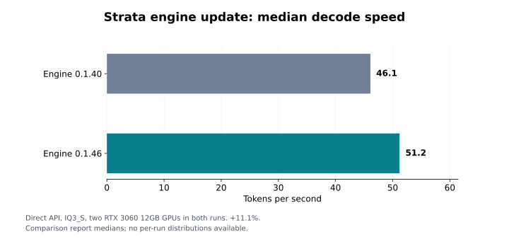
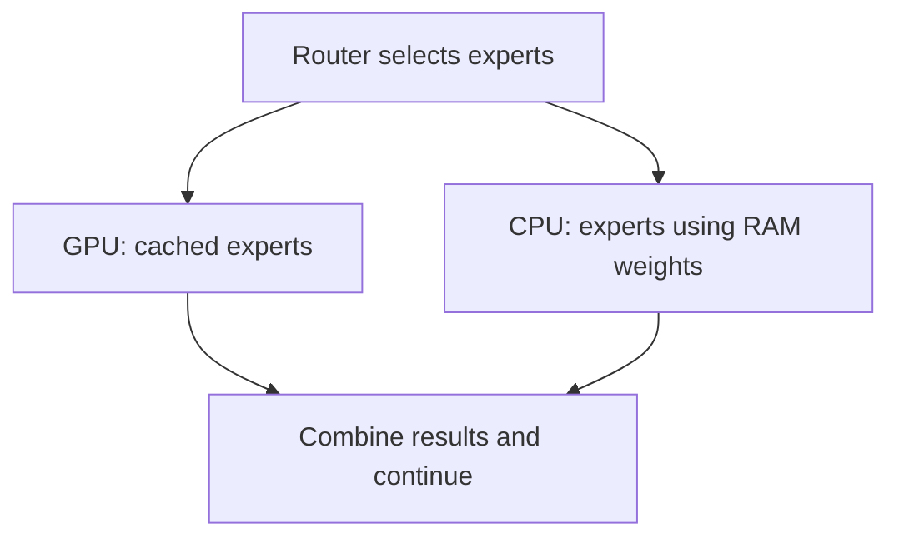
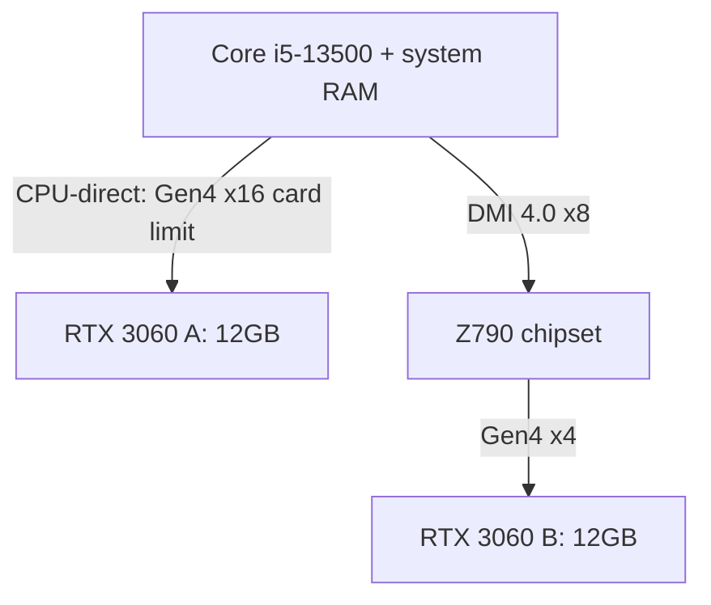
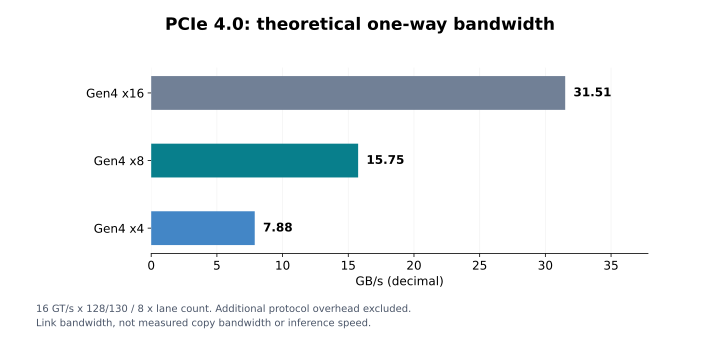

# Qwen3.8-Flash-Next on Two RTX 3060 12GB GPUs with Strata

**Practical local agent work on a desktop PC with 64GB RAM, using GPU expert caching and CPU/GPU cooperation.**

Author: [Makoto Watanabe](https://github.com/nabe2030), IoT Media Laboratory  
Measurements: October 21, 2026 · Release information checked: October 24, 2026  
Japanese article: [Qiita — Strata on RTX 3060 12GB ×2](https://qiita.com/nabe2030/items/276ec03bd92e0052f412)

## What worked

Strata made Qwen3.8-Flash-Next usable for agent tasks on a desktop with **two second-hand RTX 3060 12GB cards and 64GB of system RAM**.

- **51.2 tokens/s median decode speed** through the direct API with engine 0.1.46, up from 46.1 with 0.1.40: approximately **11.1% faster**.
- **All 10 OpenCode v2.0.24 tasks passed** on both engines. Recorded tool failures fell from 5 to 0 in this test set.
- **All 3 direct-API quality checks passed** on each engine, including the reported 256K-context test condition.
- OpenCode processed individual inputs of approximately **230K tokens** during the agent tests, with automatic conversation compaction.

This is the useful outcome: a model we previously ran on large-memory machines can also complete our agent tasks on a conventional desktop. Strata uses the PC's CPU, RAM and SSD alongside the GPUs to make that possible.

The 51.2 tokens/s figure is a **direct-API decode measurement**, not an OpenCode task-completion rate. Both sides of the engine comparison used the same two GPUs.

## Test machine

| Component | Configuration |
|---|---|
| CPU | Intel Core i5-13500: 6 P-cores + 8 E-cores, 20 threads |
| System RAM | 64GB DDR4 |
| GPUs | 2 × NVIDIA GeForce RTX 3060 12GB |
| Motherboard | MSI PRO Z790-P DDR4 |
| Storage | 500GB NVMe SSD |
| OS | Ubuntu 22.04.5 LTS |
| Model | Qwen3.8-Flash-Next, IQ3_S |
| Engines compared | Strata 0.1.40 and 0.1.46 |
| Agent client | OpenCode v2.0.24 on a separate PC |

The two cards have **24GB of aggregate VRAM**, with a separate 12GB limit on each card. Model weights, expert caches, KV caches and working buffers have to fit their respective allocations. This is not a single contiguous 24GB memory pool.

The recorded IQ3_S GGUF files occupy approximately 77.88GiB across two shards. File size is not the same as resident RAM usage; the entire checkpoint is not held in the GPUs' 24GB of VRAM.

## Why Flash-Next?

We wanted to use this model for work that involves reading an unfamiliar system, checking assumptions and deciding what to do next.

In an [earlier seven-model OpenCode comparison](https://qiita.com/nabe2030/items/ad2b6c223e5992ba78e4), Flash-Next scored 45/45 across three investigation and design tasks. In one case it inspected SELinux policy sources and reproduced the execution context, discovering that the proposed scanning process would not be allowed to read the target files.

That earlier test used DGX Spark, NVFP4 and OpenCode 1.18.25. It motivated this experiment; the IQ3_S/OpenCode v2 configuration was evaluated separately.

### How large is the model?

The official designation is **125B-A6B**: a 125B MoE body with approximately 6B active parameters per token, plus a separate 51B n-gram embedding table, PLE.

| Part | Parameters | Approximate BF16 weight size |
|---|---:|---:|
| MoE body | 125B | 250GB |
| PLE embedding table | 51B | 102GB |
| Total, excluding MTP | 176B | 352GB |

Here, “176B” means body plus PLE. The additional 4B MTP head is excluded. These are rounded parameter counts and decimal GB, calculated at two bytes per parameter; KV caches and runtime buffers are additional.

MoE reduces the computation needed per token, but the inactive experts still need storage. PLE offers another opportunity: each token looks up only a small part of the table, so it can live on SSD while the needed rows are read on demand.

The attention stack also helps with long contexts: 36 of its 48 layers use Gated DeltaNet and 12 use Qwen Sparse Attention, reducing KV-cache growth compared with a full-attention stack.

Previously we used body quantization plus SSD-backed PLE on a [128GB DGX Spark](https://github.com/nabe2030/flashnext-dgx-spark) and an [EVO-X2 with 96GB assigned to the GPU](https://qiita.com/nabe2030/items/7cc3bd2c090946e55470). Strata extends the approach by sharing expert computation between CPU and GPU.

## How Strata uses the whole PC

During decode, frequently used experts are cached in VRAM. Experts not held in that cache can be computed on the CPU using weights in system RAM, in cooperation with the GPU work. The GPU also handles attention and other operations and stores KV-cache and working data.

This diagram shows the basic decode arrangement when CPU-side expert weights are available in RAM. It is not a measured allocation map for this machine. Cache updates and some expert transfers are also involved; prefill uses a different schedule, including transfers of upcoming layers' experts.

SSD-backed PLE lookup and reading expert weights through a memory-mapped file are separate operations. For memory-mapped experts, the OS page cache affects how much physical SSD I/O occurs.

### How this relates to familiar multi-GPU methods

| Method | What is distributed | Main implication |
|---|---|---|
| Layer splitting | Different layers on different GPUs | A single request progresses through the assigned stages |
| Tensor parallelism | Weights and computation within a layer | Intermediate results need exchange or reduction |
| Expert parallelism | MoE experts across devices | Inputs are routed to selected experts, then results are collected |
| CPU offload | Weights or computation on the CPU side | CPU performance, RAM bandwidth and transfers matter |
| Strata's arrangement discussed here | GPU expert caches plus CPU-side expert computation | GPU capacity and the rest of the PC contribute together |

These can be combined. Strata's arrangement is more than dividing experts between two GPUs. Other engines, including current llama.cpp, also provide CPU-MoE and expert-cache options; this report is not a controlled performance comparison against them.

## The PCIe detail: x16 + x4, through different paths

The motherboard's two relevant slots have different connections:

The upper slot supports PCIe 5.0 x16, but the RTX 3060 card supports Gen4. The lower slot is chipset-connected PCIe 4.0 x4. This board therefore provides **x16 + x4**, rather than x8 + x8, for these cards.

These are specification limits, not measurements of negotiated link width under Strata load. The NVMe drive's actual connection and GPU peer-to-peer availability were not established in this study. RTX 3060 has no NVLink support.

Theoretical one-way bandwidth after 128b/130b encoding is approximately 31.51GB/s for Gen4 x16, 15.75GB/s for x8 and 7.88GB/s for x4, before additional protocol overhead.

An x4 connection has one quarter of x16's theoretical bandwidth, but its effect on inference depends on how much time is spent waiting for transfers. GPU computation, CPU expert work, RAM access and synchronization also contribute. Transfers may overlap with computation. DMI is shared with other chipset I/O, but the topology alone does not establish contention or saturation.

## Engine 0.1.40 → 0.1.46: results

The comparison reused the existing IQ3_S GGUF and pack, with the newer engine installed separately. OpenCode version and task set were held constant. The baseline used five expert workers pinned to distinct P-cores.

The comparison **did not load the MTP assets**. “MTP off” here does not mean that all other speculative mechanisms, such as prompt lookup, were disabled.

| Metric | Engine 0.1.40 | Engine 0.1.46 |
|---|---:|---:|
| Direct-API quality checks | 3/3 passed | 3/3 passed |
| Median decode speed | 46.1 tokens/s | 51.2 tokens/s |
| Prefill and total time | Reference | Approximately unchanged |
| OpenCode v2 tasks | 10/10 passed | 10/10 passed |
| Recorded tool failures | 5 | 0 |
| Largest actual OpenCode input | 230,867 tokens | 230,526 tokens |
| Automatic OpenCode compaction | Yes | Yes |

Decode improved by approximately 11.1%. Prefill and total time remained approximately unchanged, so the increase in generation speed should not be read as an equal reduction in whole-task duration.

Three preliminary runs with an incorrect reserve setting were retained in the experiment records but excluded from the main comparison. The zero tool-failure count is an observation from this task set, not a general failure-rate estimate.

The figures and table use the completed comparison report's medians and counts. Raw per-run logs have not been reaggregated for this publication; per-run distributions and confidence intervals are not available here. The summary CSV is in [results/engine-comparison.csv](results/engine-comparison.csv).

### Long-context work

The direct-API 256K quality test passed under the IQ3_S, MTP-assets-not-loaded condition. OpenCode completed the task set with inputs reaching approximately 230K tokens, while automatically compacting its conversation.

The practical finding is that the desktop configuration handled long-context agent work successfully in these tests. It does not demonstrate an uncompacted 256K agent session or preserve every capability of a higher-precision checkpoint.

## Updates after our measured engine: snapshot on October 24, 2026

The latest official release we checked was **0.2.3.1**, published October 23 at 13:45 UTC. Its engine packages remain **0.1.48**. Our measured engine was **0.1.46**.

| Release | Engine | Relevant changes |
|---|---|---|
| 0.2.2 | 0.1.47 | Faster NVIDIA Gyro decoding; Main/Helper/Off GPU roles; improved model-storage management |
| 0.2.3 | 0.1.48 | Automatic conversation-cache sizing; opt-in DFlash2 in the Terminal; Strix Halo improvements; Linux Intel Arc engine distribution; chat and Terminal fixes |
| 0.2.3.1 | Still 0.1.48 | Setup fixes in Control 0.1.48.1; app remains 0.2.3 |

In the official 0.2.2 measurements on an RTX 3060 12GB, Gyro-S rose from 54.3 to 62.5 tokens/s and Gyro-M from 50.2 to 54.8. These use **different quantization formats from our IQ3_S test**.

For agent use, the 0.2.3 conversation-cache change is particularly interesting. In the upstream two-agent, shared-model test, prompt reuse increased from 0% to 91%, and a follow-up turn fell from 11 seconds to 3. That illustrates why repeated-input processing matters alongside decode speed.

DFlash2 is opt-in through the Terminal; Auto still selects MTP. Strata's own chat also gained context summarization and recovery, which is separate from OpenCode's conversation management.

These are upstream reports, not additional measurements on our dual-3060 IQ3_S setup. Our interest is in how the improvements translate into everyday agent work on the hardware already at hand.

## Related work: GembaBench

We also publish [GembaBench](https://github.com/nabe2030/gembabench), a server-operations agent benchmark covering system surveys, intrusion investigation, upgrade planning and execution, hardening and a SQL-injection fix.

Its v0.1 report includes **54 trials across DGX Spark, RTX 4060 Ti 16GB + Strata, and RTX 3060 12GB ×2 + Strata**. It publishes the environment, runner, judging tools and per-trial summary data.

GembaBench uses **OpenCode 2.0.25 and MTP 4** on the Strata configurations. It is a separate experiment from the **OpenCode 2.0.24 / MTP-assets-not-loaded** engine comparison above. Its scores and trial counts should not be combined with this report's 10-task result.

## What this experiment established

**Two second-hand RTX 3060 12GB cards, 64GB RAM and an NVMe SSD were enough to make Flash-Next a practical local-agent option in our tests.** Strata achieved this by putting the CPU and memory system to work alongside the GPUs. Engine 0.1.46 delivered a median 51.2 tokens/s through the direct API and passed all 10 OpenCode v2 tasks.

The result makes this desktop configuration worth using for real work. The next developments we care about are responsiveness across long conversations and reliable task completion as Strata continues to evolve.

## References

- [Original Japanese article and experiment summary](https://qiita.com/nabe2030/items/276ec03bd92e0052f412)
- [Strata: how it works, v0.2.1](https://github.com/Niko1221/Strata/blob/v0.2.1/docs/HOW_IT_WORKS.md)
- [Strata implementation details, v0.2.1](https://github.com/Niko1221/Strata/blob/v0.2.1/docs/DETAILS.md)
- [Strata 0.2.2](https://github.com/Niko1221/Strata/releases/tag/v0.2.2), [0.2.3](https://github.com/Niko1221/Strata/releases/tag/v0.2.3), [0.2.3.1](https://github.com/Niko1221/Strata/releases/tag/v0.2.3.1)
- [Qwen3.8-Flash-Next model card](https://huggingface.co/Qwen/Qwen3.8-Flash-Next)
- [MSI PRO Z790-P DDR4 specifications](https://www.msi.com/Motherboard/PRO-Z790-P-DDR4/Specification)
- [Intel Core i5-13500 specifications](https://www.intel.co.jp/content/www/jp/ja/products/sku/230580/intel-core-i513500-processor-24m-cache-up-to-4-80-ghz/specifications.html)
- [NVIDIA RTX 3060 specifications](https://www.nvidia.com/en-us/geforce/graphics-cards/30-series/rtx-3060-3060ti/)
- [llama.cpp server documentation](https://github.com/ggml-org/llama.cpp/blob/master/tools/server/README.md)
- [CUDA Best Practices Guide](https://docs.nvidia.com/cuda/cuda-c-best-practices-guide/index.html)
- [Flash-Next on DGX Spark: our recipe and results](https://github.com/nabe2030/flashnext-dgx-spark)
- [GembaBench v0.1](https://github.com/nabe2030/gembabench)

## About the author

I work on IoT and AI evaluation at the nonprofit IoT Media Laboratory in Japan. Our local-LLM work focuses on what happens on real hardware: speed, Japanese knowledge, coding and multimodal tasks, including investigating failures rather than stopping at a successful launch.

Hardware support, evaluation collaborations and joint research inquiries are welcome via [GitHub](https://github.com/nabe2030).
